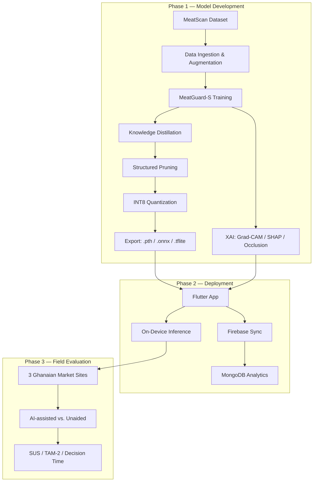

# MeatGuard II
### Explainable Lightweight AI for Real-Time Cow Meat Freshness Detection on Edge Devices

[](LICENSE)
[](pyproject.toml)
[](https://pytorch.org)
[](https://flutter.dev)
[]()
[]()

---

## Table of Contents

- [Overview](#overview)
- [Architecture](#architecture)
- [Installation](#installation)
- [Usage](#usage)
- [Dataset](#dataset)
- [Model](#model)
- [Results](#results)
- [Project Structure](#project-structure)
- [Citation](#citation)
- [License](#license)

---

## Overview

**MeatGuard II** is the second project in the MeatScan research programme. It advances beyond benchmark accuracy to deploy the best-performing architecture as a lightweight, explainable model running in real time on **Android smartphones** and **Raspberry Pi** devices.

### Key Contributions

| Contribution | Description |
|---|---|
| **MeatGuard-S Architecture** | Custom lightweight CNN-Transformer hybrid (~3.4M params) achieving >92% F1 on MeatScan with <100ms inference latency. |
| **Knowledge Distillation** | Teacher-student compression from the Project 1 champion (Swin-B / EfficientNet-B4) with <5% accuracy degradation. |
| **Dual XAI Framework** | Integrated Grad-CAM (spatial) and SHAP (channel-wise) explanations for non-expert food inspectors. |
| **On-Device Deployment** | Cross-platform Flutter app with offline TFLite inference and GPU/NNAPI delegate acceleration. |
| **Field Evaluation** | First in-field user study of an AI meat freshness tool in sub-Saharan Africa (N=40 inspectors, 3 market sites). |

### Target Journal
**Expert Systems with Applications** (Elsevier, Q1, IF ~8.5) | Alternative: *Trends in Food Science & Technology* (Q1, IF ~15.1)

---

## Architecture



---

## Installation

### Prerequisites
- Python 3.12+
- PyTorch 2.x
- CUDA-capable GPU (recommended for training)
- Flutter SDK (for mobile deployment)

### Setup

```bash
# Clone the repository
git clone https://github.com/your-org/MeatGuard_II.git
cd MeatGuard_II

# Create a virtual environment (recommended)
python -m venv .venv
source .venv/bin/activate   # Linux/Mac
# .venv\Scripts\activate    # Windows

# Install core dependencies
pip install -r requirements.txt
```

### Quick Start

```bash
# Run the full pipeline using the Makefile
make setup
make train
make distill
make compress
make export

# Or run individual stages with custom config
python src/main.py --config configs/config.yaml --mode training
```

---

## Dataset

**MeatScan** — 11,000 RGB images of fresh and spoiled cow meat captured in Ghanaian market conditions.

| Property | Value |
|---|---|
| Total Images | 11,000 (5,627 fresh / 5,373 spoiled) |
| Resolution | High-resolution RGB (smartphone-captured) |
| Capture Environments | Open-air markets, butcher shops, cold storage |
| Class Balance | Near-balanced (~51% / ~49%) |
| Access | Open access — [Zenodo DOI: 10.5281/zenodo.16764338](https://zenodo.org) |
| Publication | Gyening et al., *Data in Brief*, Elsevier, 2025 |

The data at `D:\Research_Work\MeatGuard\data\test` is only a placeholder, make sure it is replaced by the actual path to the full dataset. Switch to the full MeatScan dataset by changing `configs/data/` pointer.

---

## Model

### MeatGuard-S Architecture

| Stage | Module | Output Size | Purpose |
|---|---|---|---|
| Input | 224×224×3 normalised | 224²×3 | ImageNet normalisation |
| Stage 1 | Depthwise-Separable Conv ×2 | 56×56×64 | Local edge and colour features |
| Stage 2 | Inverted-Residual (MV2) ×3 | 28×28×128 | Mid-level texture hierarchy |
| Stage 3 | Compact MHSA (4 heads, d=256) | 14×14×256 | Global spatial relationships |
| Stage 4 | MV2 + SE Attention | 7×7×384 | Refined channel attention |
| Head | GAP → Dropout(0.3) → FC(2) | 2 | Binary classification |
| **Total** | **MeatGuard-S** | **~3.4M params** | **<8MB TFLite** |

### Model Formats

| Format | Size | Use Case |
|---|---|---|
| `.pth` | ~13 MB | Training, research, fine-tuning |
| `.onnx` | ~13 MB | Cross-platform inference |
| `.tflite` (FP32) | ~13 MB | High-precision mobile inference |
| `.tflite` (INT8) | ~3.5 MB | Edge device deployment (<8MB target) |

---

## Results

| Metric | Target | MeatGuard-S (KD) | MeatGuard-S (INT8) |
|---|---|---|---|
| Macro F1 | >92% | TBD | TBD |
| FNR (False Negative Rate) | Minimised | TBD | TBD |
| AUC-ROC | — | TBD | TBD |
| Inference Latency (RPi 5) | <100ms | TBD | TBD |
| Model Size | <8MB | ~13 MB | ~3.5 MB |

*Results will be populated as experiments are completed.*

---

## Project Structure

```
MeatGuard_II/
├── configs/              # Hydra/OmegaConf YAML configurations
│   ├── config.yaml       # Master switchboard
│   ├── data/             # Dataset-specific configs
│   ├── model/            # Architecture blueprints
│   ├── train/            # Training & augmentation configs
│   └── viz/              # Visualization styles & plot configs
├── src/                  # Core Python package
│   ├── data/             # Data ingestion, transforms, loaders
│   ├── model/            # Architectures, distillation, compression
│   ├── xai/              # Grad-CAM, SHAP, Occlusion, Faithfulness
│   ├── utils/            # Config manager, viz manager, export
│   ├── dashboard/        # Streamlit research dashboard
│   └── main.py           # CLI entry point
├── notebooks/            # Colab/Kaggle prototyping notebooks
├── mobile_app/           # Flutter mobile application
<!-- ├── serving/              # FastAPI backend + Firebase/MongoDB -->
<!-- ├── field_eval/           # Field study protocol and analysis -->
├── artifacts/            # Outputs (DVC-tracked)
├── tests/                # pytest suites
├── Makefile              # Pipeline orchestration
├── requirements.txt      # Python dependencies
<!-- ├── Dockerfile            # Reproducible training image -->
<!-- └── docs/                 # mkdocs documentation -->
```

---

<!--
## Citation

If you use this work in your research, please cite:

```bibtex
@article{meatguard2026,
  title={MeatGuard: An Explainable Lightweight Hybrid CNN-Transformer Model
         for Real-Time Cow Meat Freshness Detection on Smartphone and
         Raspberry Pi Devices in Low-Resource African Markets},
  author={Gyening, R.-M. O. M. and others},
  journal={Expert Systems with Applications},
  year={2026},
  publisher={Elsevier}
}
```

Also cite the MeatScan dataset:

```bibtex
@article{gyening2025meatscan,
  title={MeatScan: An image dataset for machine learning-based
         classification of fresh and spoiled cow meat},
  author={Gyening, R.-M. O. M. and Akoto, M. A. and Owusu-Agyemang, K.
          and Amoako-Banning, L. and Takyi, K. and Appiahene, P.},
  journal={Data in Brief},
  volume={62},
  pages={112045},
  year={2025},
  publisher={Elsevier}
}
```
-->
---

## License

This project is licensed under the **MIT License** — see the [LICENSE](LICENSE) file for details. The MeatGuard model weights and TFLite exports are released open-source for immediate deployment by health authorities, in line with the open-source commitment of the research proposal.

---

## Responsible AI

This tool provides **AI-assisted guidance only**. Official food safety decisions must be made by qualified inspectors under applicable national law. Model limitations (e.g., performance degradation in extreme lighting) are documented in the app and accompanying model card.
