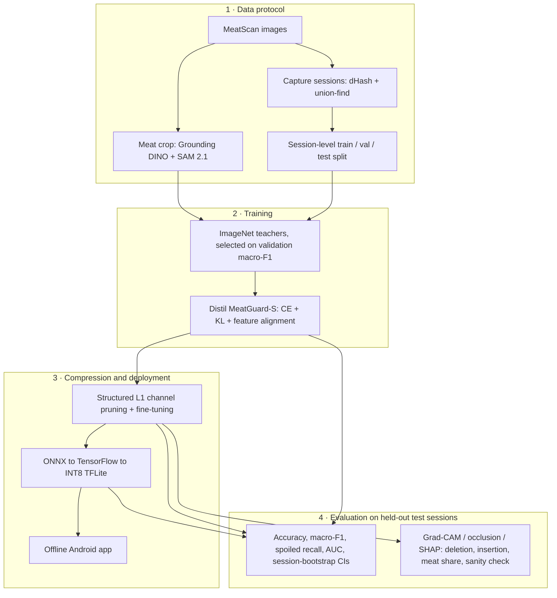

# MeatGuard II
### MeatGuard-S: An Explainable Lightweight Deep Neural Network for Beef Freshness Classification on Smartphones

[](LICENSE)
[](requirements.txt)
[](https://pytorch.org)
[](https://flutter.dev)
[]()
[]()

---

## Table of Contents

- [Overview](#overview)
- [Architecture](#architecture)
- [Installation](#installation)
- [Running the experiments](#running-the-experiments)
- [Dataset](#dataset)
- [Model](#model)
- [Results](#results)
- [Project Structure](#project-structure)
- [Citation](#citation)
- [License](#license)

---

## Overview

**MeatGuard II** is the second project in the MeatScan research programme. It turns the benchmark of Project 1
into a lightweight, explainable cow-meat freshness classifier that runs offline on **Android smartphones**.
Raspberry Pi deployment and an in-field user study are future work.

### Key Contributions

| Contribution | Description |
|---|---|
| **Leakage-free evaluation protocol** | MeatScan contains burst frames of the same piece of meat. Images are grouped into capture sessions by perceptual hashing and whole sessions are assigned to train / validation / test; backgrounds are removed by cropping each image to its meat region (Grounding DINO + SAM 2.1). |
| **MeatGuard-S** | Convolution–transformer hybrid with 1.14 M parameters and 0.38 GMACs (224 × 224), distilled from an ImageNet-pretrained teacher chosen on validation data, then structurally pruned (0.85 M parameters) and INT8-quantised for TFLite. |
| **Evaluated explanations** | Grad-CAM, occlusion sensitivity and SHAP, scored by deletion / insertion AUC against a random baseline, by the share of attribution falling on the meat (using the segmentation masks), and by a weight-randomisation sanity check. |
| **On-device deployment** | Offline Android app with the INT8 TFLite model; accuracy is reported after every compression step and latency is measured on the phones. |

### Target Journal
**Computers and Electronics in Agriculture** (Elsevier) | Alternative: *Expert Systems with Applications* (Elsevier)

---

## Architecture



---

## Installation

### Prerequisites
- Python 3.12+
- PyTorch 2.x
- CUDA-capable GPU (recommended for training)
- Flutter SDK (for mobile deployment)

### Setup

```bash
# Clone the repository
git clone https://github.com/your-org/MeatGuard_II.git
cd MeatGuard_II

# Create a virtual environment (recommended)
python -m venv .venv
source .venv/bin/activate   # Linux/Mac
# .venv\Scripts\activate    # Windows

# Install core dependencies
pip install -r requirements.txt
```

---

## Running the experiments

Step-by-step instructions, in order, for the Makefile, the Python scripts and the Colab notebooks: [RUNBOOK.md](RUNBOOK.md).

Each step is a script that writes its results under `runs/` (checkpoints, `history.csv`, and `summary.json` with
the settings, model cost, metrics, GPU and software versions). The notebooks in `notebooks/` drive the same scripts
on Google Colab, with the codebase and the data on Google Drive.

### Data preparation (local, once)

Paths in this README are relative to the repository root: raw images in `data/raw/MeatScan/`, prepared
data in `data/processed/full/` (both git-ignored). If your data live elsewhere, set the locations in
`configs/data/meatscan_crops.yaml`, which `src/main.py` and the `Makefile` read.

```bash
python -m src.data.sessions     --src data/raw/MeatScan --out data/processed/full/sessions.csv   # session split
python -m src.data.segment_meat --src data/raw/MeatScan --out data/processed/full               # masks/ masked/ crops/
```

For Colab, zip `crops/`, `masks/` and `sessions.csv` from `data/processed/full` and upload the zip to Drive
(default `MyDrive/MeatGuard/full.zip`); upload this repository folder to `MyDrive/MeatGuard_II`.

### Training and evaluation

| Step | Notebook | Command | Results |
|---|---|---|---|
| Teacher candidates and selection | `00_teacher_training` | `python -m src.train_teacher train --arch <arch> --data <crops>`, then `python -m src.train_teacher select --data <crops>` | `runs/teacher/` |
| Baselines and no-KD ablation | `01_meatguard_training` | `python -m src.train_teacher train --arch mobilenet_v3_small --data <crops> --out runs/baselines`; `python -m src.train_student distill --no-kd --data <crops>` | `runs/baselines/`, `runs/student/scratch/` |
| Distillation, pruning, export | `02_distill_compress_export` | `python -m src.train_student distill --data <crops>`, then `compress`, then `export` | `runs/student/distilled/`, `pruned/`, `export/` |
| Test evaluation of all models | `03_inference_and_xai` | `python -m src.evaluate --data <crops>` | `runs/results/` |
| Evaluation of the explanations | `04_xai_faithfulness` | `python -m src.evaluate_xai --data <crops>` | `runs/xai/` |

`<crops>` is `data/processed/full/crops`; `sessions.csv` is found next to it. Run the notebooks in order (01 does not
need the teacher). Training runs are resumable, and every command has a `--smoke` option that runs three batches
to check the setup.

Model selection uses validation data only. The test split is used by `train_teacher select` (once, for the selected
teacher) and by `src.evaluate`. To share the results, `python -m src.collect_results --runs runs` bundles all JSON
and CSV outputs (no weights) into `results_bundle.zip`; each notebook ends with this step.

### One command (local or any machine with a GPU)

`src/main.py` runs any step, or the whole pipeline, with the settings in `configs/config.yaml`; the `Makefile`
wraps it and skips steps whose results already exist.

```bash
make                                    # teacher -> baselines -> scratch -> distill -> compress -> export -> evaluate -> xai -> collect
make distill                            # one step (plus any missing prerequisites)
make smoke                              # whole pipeline, three batches per step, results in runs_smoke/
make dry-run                            # print the commands only
make PYTHON=.venv/Scripts/python.exe RUNS=runs_local

python -m src.main --mode distill       # the same without make
python -m src.main --mode sessions      # data preparation steps: sessions, segment
```

---

## Dataset

**MeatScan** (Gyening et al., *Data in Brief*, 2025): RGB smartphone images of fresh and spoiled cow meat from
Ghanaian markets. Open access: [Zenodo, doi:10.5281/zenodo.16764338](https://doi.org/10.5281/zenodo.16764338).

| Property | Value |
|---|---|
| Images used | 10,518 (5,627 fresh / 4,891 spoiled) |
| Capture sessions | 1,666 (1,012 single images; the largest holds 2,619 images, 53.5% of the spoiled class) |
| Split (fresh / spoiled) | train 3,939 / 3,423 · val 844 / 734 · test 844 / 734, by session, stratified by class |
| Leakage check | no validation or test image within dHash distance 6 of a training image |
| Model input | `data/processed/full/crops/`: 224 × 224 crops of the meat region, background filled with the ImageNet mean colour |

Prepared data (`data/processed/full/`): `sessions.csv` (path, class, session, split), `masks/` (binary meat masks),
`masked/` (background removed), `crops/` (model input) and `segmentation.csv` (detector scores, mask areas and
fallback flags). The dataset config is selected in `configs/config.yaml` (`data: "meatscan_crops"`).

---

## Model

### MeatGuard-S Architecture

| Stage | Module | Output Size | Params (k) | MACs (M) |
|---|---|---|---|---|
| 1 | 3 × 3 conv, stride 2; depthwise-separable conv, stride 2 | 56 × 56 × 64 | 3.5 | 18.2 |
| 2 | 3 × inverted residual (expansion 2), first with stride 2 | 28 × 28 × 128 | 164.7 | 145.8 |
| 3 | 1 × 1 projection; 2 × 2 max pool; pre-norm transformer block (4 heads) | 14 × 14 × 256 | 559.6 | 148.1 |
| 4 | Inverted residual (expansion 2); squeeze-and-excitation; 2 × 2 max pool | 7 × 7 × 384 | 409.3 | 65.2 |
| Head | Global average pooling; dropout 0.3; linear | 2 | 0.8 | < 0.1 |
| **Total** | | | **1,137.9** | **377.3** |

MACs include the attention products. After 30% structured pruning: 0.85 M parameters and 0.24 GMACs (convolutional
and linear layers).

### Model Formats

| File | Written by | Use |
|---|---|---|
| `runs/student/distilled/best.pt` | `train_student distill` | state dict of the distilled model (about 4.4 MB) |
| `runs/student/pruned/best_model.pt` | `train_student compress` | whole pruned module, load with `torch.load(path, weights_only=False)` (about 3.3 MB) |
| `runs/student/export/meatguard_s.onnx` | `train_student export` | portable FP32 model |
| `runs/student/export/meatguard_s_int8.tflite` | `train_student export` | INT8 model for the Android app (size in `export/summary.json`) |

---

## Results

Results are written by the scripts and are not yet available. The paper tables are filled from:

| Result | File |
|---|---|
| Teacher ranking (validation) and test metrics | `runs/teacher/teacher_selection.json` |
| Test metrics, 95% CIs, cost, CPU latency and McNemar tests for all models | `runs/results/test_results.json` / `.csv` |
| Per-image test predictions | `runs/results/predictions.csv` |
| Pruning cost and accuracy before / after fine-tuning | `runs/student/pruned/summary.json` |
| INT8 vs FP32 agreement, file sizes | `runs/student/export/summary.json` |
| Grad-CAM layer, deletion / insertion AUC, meat share, sanity check | `runs/xai/xai_summary.json`, `xai_per_image.csv`, `sanity_check.csv` |
| On-device latency | measured in the Android app |

---

## Project Structure

```
MeatGuard_II/
├── configs/               # YAML configurations: config.yaml holds all step settings and selects the dataset
├── src/                   # Core Python package (see src/README.md)
│   ├── data/              # Session split, meat segmentation, transforms, loaders
│   ├── model/             # MeatGuard-S, teachers and baselines, distillation, pruning
│   ├── xai/               # Grad-CAM, SHAP, occlusion, faithfulness measures
│   ├── utils/             # Metrics, export (ONNX / INT8 TFLite), config and plotting helpers
│   ├── viz/               # Paper figures (pipeline, architecture, flowcharts)
│   ├── dashboard/         # Streamlit research dashboard
│   ├── train_teacher.py   # Teacher and baseline training, teacher selection
│   ├── train_student.py   # Distillation, pruning + fine-tuning, export
│   ├── evaluate.py        # Test evaluation of all models
│   ├── evaluate_xai.py    # Evaluation of the explanations
│   ├── collect_results.py # Bundle the result files to share
│   └── main.py            # Config-driven runner for all steps (configs/config.yaml)
├── notebooks/             # Colab notebooks 00-04 that drive the scripts above
├── runs/                  # Results (git-ignored): checkpoints, histories, summaries
├── mobile_app/            # Android application
├── artifacts/             # Earlier outputs and downloaded weights
├── Makefile               # Pipeline targets (calls src/main.py)
├── RUNBOOK.md             # How to run the experiment, in order
└── requirements.txt       # Python dependencies
```

---

<!--
## Citation

If you use this work in your research, please cite:

```bibtex
@article{meatguard2026,
  title={MeatGuard-S: An Explainable Lightweight Deep Neural Network for Beef
         Freshness Classification on Smartphones},
  author={Gyening, R.-M. O. M. and others},
  journal={Computers and Electronics in Agriculture},
  year={2026},
  publisher={Elsevier}
}
```

Also cite the MeatScan dataset:

```bibtex
@article{gyening2025meatscan,
  title={MeatScan: An image dataset for machine learning-based
         classification of fresh and spoiled cow meat},
  author={Gyening, R.-M. O. M. and Akoto, M. A. and Owusu-Agyemang, K.
          and Amoako-Banning, L. and Takyi, K. and Appiahene, P.},
  journal={Data in Brief},
  volume={62},
  pages={112045},
  year={2025},
  publisher={Elsevier}
}
```
-->
---

## License

This project is licensed under the **MIT License** — see the [LICENSE](LICENSE) file for details. The MeatGuard model weights and TFLite exports are released open-source for immediate deployment by health authorities, in line with the open-source commitment of the research proposal.

---

## Responsible AI

This tool provides **AI-assisted guidance only**. Official food safety decisions must be made by qualified inspectors under applicable national law. The model was trained and tested on MeatScan images only; its behaviour with other cameras, lighting and markets has not yet been evaluated.
